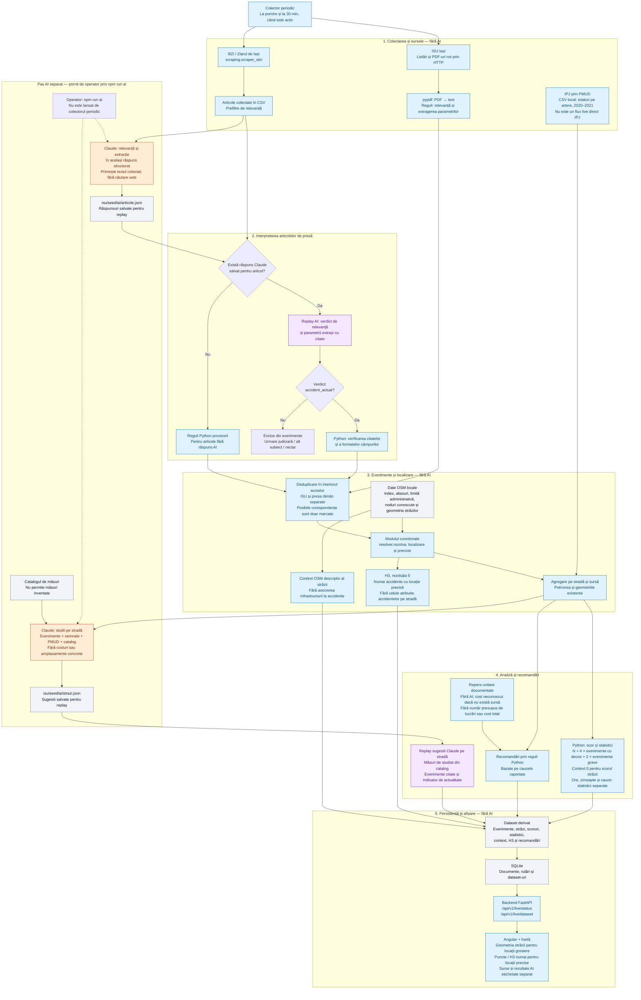

# Fluxul aplicației — surse, AI, geolocalizare și analiză

Diagrama descrie implementarea actuală. Se poate vizualiza în preview-ul Markdown
cu suport Mermaid sau direct pe GitHub.

**Legendă:** albastru = procesare fără AI; portocaliu = apel nou la model;
mov = reutilizarea unui răspuns AI salvat. Săgețile punctate indică pornirea
separată a pasului AI de către operator.

Colectarea periodică reutilizează răspunsurile AI salvate. `npm run ai`
procesează articolele noi, reconstruiește dataset-ul, generează/actualizează
sugestiile eligibile și salvează rezultatele în SQLite și în `isu/seed/`.
Modelul configurat implicit în `isu/ai.py` este `claude-haiku-5-5`.

IPJ/PMUD rămâne un total separat; nu fabricăm evenimente individuale, ore sau
cauze pentru acel tabel. Scorul prioritizează evenimentele documentate și nu
reprezintă probabilitatea unui accident. Recomandările pe stradă sunt studii;
o modificare de trecere sau amplasarea unui limitator cere un loc verificat și
evaluare tehnică.

Diagrama arată fluxul existent, inclusiv regulile provizorii. Problemele de
prefiltrare, validare, deduplicare și verificare a nodurilor OSM sunt descrise
în [auditul fluxului](../risk/PIPELINE_AUDIT.md); nu sunt prezentate ca rezolvate.

Puncte de intrare în cod: [colector periodic](../isu/live.py),
[colectare ISU](../isu/collect.py), [pas AI](../isu/ai.py),
[asamblare și geolocalizare](../isu/build.py),
[analiză pe străzi](../risk/streets.py), [API live](../api/live_router.py).
