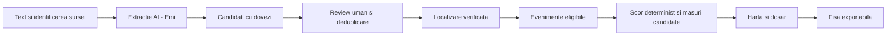

# SafeIași — plan complet de execuție pentru concurs

Plan propus la **17 octombrie 2026, aproximativ 15:40, Europe/Bucharest**. Scopul este maximizarea șanselor printr-un produs demonstrabil și dovezi credibile; rezultatul jurizării nu poate fi garantat. Acesta este un plan de lucru, nu o descriere a unor funcționalități deja implementate și nici o confirmare a deciziilor întregii echipe.

Completează [planul inițial de 25 de ore](HACKATHON_PLAN.md), [contextul proiectului](PROJECT_CONTEXT.md) și [planificarea existentă](../Planificare.md), care rămân nemodificate. Recomandările care diferă de ele sunt explicite mai jos. Cererea curentă este de planificare: nu continuăm acum implementarea API-ului.

## 1. Rezultatul pe care trebuie să îl demonstrăm

**„SafeIași transformă surse disparate despre accidente într-un dosar verificabil, care ajută administrația să decidă ce locație verifică în teren și pe ce dovezi.”**

Utilizatorul operațional vizat este un specialist din mobilitate/siguranță rutieră; clientul vizat este Primăria Iași. Nu avem contract, parteneriat, acces la date oficiale sau validare de client confirmate. Distingem clar mentorul, utilizatorul intervievat și clientul contractant.

Pentru prezentare alegem un singur fir narativ: **articol → extracție cu dovezi → verificare/deduplicare → locație → prioritate explicată → măsură candidată → fișă exportabilă**. Diferențiatorul propus este trasabilitatea deciziei și controlul uman. Nu afirmăm că suntem unici sau că nu există competitori fără o cercetare care susține asta.

## 2. Clarificări primite privind participarea și predarea

Sursele oficiale consultate pe 17 octombrie se contrazic:

| Subiect | Pagina programului / contextul echipei | PDF-urile legate de pagină | Clarificarea primită |
|---|---|---|---|
| Termen | Pagina: 18 octombrie, 16:30–17:00 | Regulament și ghid: 16:00 | Mihnea confirmă în conversație termenul comunicat de organizatori: **16:30–17:00** |
| Număr de membri | Echipa noastră are șase persoane | Regulamentul: 2–5 membri | Mihnea confirmă în conversație că organizatorii au acceptat **șase membri** |

Surse: [program](https://markaiintegrator.ro/hackathon-ai/), [regulament, art. 3 și 7](https://markaiintegrator.ro/hackathon-ai/regulament-oficial.pdf), [ghid](https://markaiintegrator.ro/hackathon-ai/ghid-participanti.pdf). **Confirmările lui Mihnea din conversația de la 17 octombrie sunt baza operațională a planului:** lucrăm în șase și predăm în intervalul 16:30–17:00. Diferențele PDF rămân consemnate pentru trasabilitate, fără a redeschide aceste confirmări. Responsabilul de produs verifică practic linkul/platforma de depunere.

La reperul **15:40** rămân aproximativ **24 h 50 min până la începutul predării, 16:30**, respectiv **25 h 20 min până la 17:00**. Pentru pachet gata la 14:30 rămân aproximativ **22 h 50 min**. Calendarul inițial de 25 de ore trebuie comprimat, păstrând odihna și repetițiile. Dacă pornim mai târziu, reducem scope-ul; termenul final nu se deplasează.

## 3. Starea reală de plecare

Verificare Git: `origin/main` la `77b0a0908ecf2b6a919a13ef003056f1c815705e` conține documentație și `false_data/`, fără aplicație funcțională sau set de accidente reale verificate. Fixture-urile sintetice conțin **4 articole, 17 evenimente, 7 obiecte de infrastructură, 5 locații și 6 măsuri**. Manifestul declară 18 articole; 14 ID-uri de articole referite lipsesc.

[PR #2](https://github.com/andrei-vladjitaru/Ctrl-Alt-Dev-2026/pull/2), ramura `codex/backend-foundation`, conține alocările backend/AI, un plan backend și un audit al fixture-urilor cu 13 teste trecute. Acest cod nu este în baza `main` inspectată și nu este API sau extracție AI. Testele sale nu acoperă funcționalitățile aplicației care urmează.

Datele sintetice existente au și costuri/reduceri fictive, locații neverificate și explicații care trebuie revizuite înaintea oricărei utilizări publice. Nu le reutilizăm drept dovezi reale. Proprietarii pot repara setul sau pot construi fixture-uri minimale coerente, izolate și etichetate; nu completăm știrile lipsă prin invenție.

## 4. Dovezile pentru criteriile juriului

Pentru jurizarea din 18 octombrie, [pagina organizatorilor](https://markaiintegrator.ro/hackathon-ai/) publică AI 30%, impact 25%, funcționalitate 25%, prezentare 20%. Traducerea în livrabile de mai jos este propunerea noastră, nu o grilă suplimentară a juriului.

| Criteriu | Dovada de pregătit | Cum verificăm |
|---|---|---|
| AI — 30% | Extracție reală cu pasaje-dovadă, necunoscute vizibile și control uman; model/prompt identificabile | O rulare reală salvată și demonstrabilă; evaluare separată, cu numărător și numitor |
| Impact — 25% | Un dosar care permite o acțiune concretă de verificare în teren; propunere de pilot | Un mentor/utilizator relevant înțelege ce ar verifica și ce îi lipsește; feedback-ul este consemnat dacă a fost obținut |
| Funcționalitate — 25% | Flux complet pe aceleași evenimente, până la export, pe laptopul de prezentare | Totalurile, ID-urile și scorul coincid; date locale și video de rezervă verificate |
| Prezentare — 20% | Poveste de 180 de secunde, lizibilă, cu un dosar principal și cerere clară | Două repetiții complete cronometrate și o persoană care nu a construit ecranul poate urmări demonstrația |

Nu ne acordăm singuri puncte și nu inventăm un procent de probabilitate de câștig.

## 5. Ce trebuie să existe în versiunea de concurs

| Livrabil obligatoriu | Criteriu concret de acceptare |
|---|---|
| Importul unei surse | Text + URL/publicație, data publicării și momentul colectării; nu depindem de un scraper pentru demonstrație |
| Extracția lui Emi | Candidați structurați, dovezi pe câmp, necunoscute păstrate, tratare JSON invalid/timeout, model și versiune de prompt |
| Verificare și deduplicare | Operatorul corectează, aprobă/respinge și poate lega o sursă de un eveniment existent; aprobarea nu se repetă accidental |
| Localizare verificată | Locație, precizie, metodă și dovadă; cazurile vagi rămân pentru review, cele din afara municipiului nu intră în clasament |
| Hartă și listă de priorități | Aceleași filtre/perioadă/totaluri; surse și mod de date vizibile; clasament cât permite eșantionul |
| Dosarul locației | Evenimente unice, surse, scor descompus, context cunoscut/lipsă, 1–3 măsuri candidate și verificări necesare |
| Export | Fișă HTML imprimabilă/PDF, lizibilă, cu aceleași ID-uri/date, surse, limite, versiune și momentul generării |
| Rezervă de demonstrație | Snapshot local identificabil și video MP4; răspunsul AI redat ulterior este etichetat reluare |

Cele trei ecrane rămân **hartă/listă**, **dosarul locației**, **import/review**. O bară vizibilă arată perioada, articolele, evenimentele distincte, cele verificate și modul sintetic/observat. Stările „nu avem date”, „localizare neclară” și „serviciu indisponibil” sunt proiectate, nu lăsate ca erori goale.

Ținte de lucru: **20 de evenimente reale distincte și verificate**, extensie la 40 numai dacă verificarea ține pasul; **trei dosare bune** și **cinci tipuri de măsuri documentate**. Pragul minim de lucru rămâne zece evenimente reale, nu o regulă a concursului. Dacă setul nu susține agregări utile sau nu atinge pragul, prezentăm onest dosare individuale și fluxul de verificare. Nu fabricăm un top sau repetări ale accidentelor. Cele trei dosare pot avea numere diferite de evenimente.

**Cohorta de fixat în primul checkpoint:** propunem evenimente rutiere raportate în municipiul Iași, cu data accidentului între **1 octombrie 2024 și 17 octombrie 2026 inclusiv**, din toate categoriile de participanți; povestea demo-ului poate evidenția cazurile cu pietoni. Aceasta extinde explicit focusul exclusiv pe pietoni din Planificare.md și trebuie consemnată ca decizie înaintea colectării comune. Geo fixează limita municipiului și sursa/versiunea ei. Un eveniment cu data sau apartenența teritorială neconfirmată rămâne în review. Intervalul este o propunere de analiză, nu dovada că avem date pentru el. Orice schimbare ulterioară a cohortei este declarată și aplicată tuturor totalurilor; presa rămâne un eșantion selectiv.

**Ordinea de investiție:** primul flux complet pe fixture-uri coerente și o extracție reală; apoi zece evenimente și un dosar excelent; apoi ținta de 20 și celelalte două dosare; apoi evaluarea, lizibilitatea și repetițiile. Testarea extracției începe în paralel cu primele surse, nu în ultima oră.

### Ce scoatem din drumul critic

SafeCross, TomTom, scraping la scară mare, predicții de accidente, simulări de „vieți salvate”, animații de reducere a accidentelor, costuri automate, H3/3D/tur cinematic, Mapillary, bază de date nouă și cloud nou. Pot intra doar dacă versiunea obligatorie trece verificările și nu ating rezerva. H3 poate fi un strat vizual; demo-ul și prioritizarea trebuie să rămână utile fără el. Nu pornim o a doua implementare frontend în paralel.

## 6. Datele și evaluarea AI

Responsabilul de produs selectează o listă mică de surse relevante, inclusiv anunțuri oficiale disponibile și presă cu URL identificabil. Emi păstrează proveniența; responsabilul geo verifică localizarea; produsul verifică evenimentul canonic și cele trei dosare. Aprobarea trebuie făcută înaintea publicării, nu doar înaintea pitch-ului.

Pentru fiecare eveniment păstrăm distinct: surse, data accidentului, data publicării, precizia datei/locului, participanți, gravitate, cauze doar ca afirmații atribuite, dovezi și verificare. Orele necunoscute nu devin 00:00. Nu colectăm numele victimelor pentru prioritizare. Păstrăm pasaje scurte și referințe; nu republicăm automat articole integrale.

**Set separat pentru evaluare:** țintă 10–15 articole reale adnotate manual, nefolosite la reglarea promptului; minimum de rezervă șase, cu limita eșantionului spusă explicit. Propunerea de rezervă reduce ținta din planul inițial; nu o prezentăm drept evaluare echivalentă. Dacă ajustăm promptul după evaluare, acel set nu mai este independent pentru noua versiune.

Raportăm câmpuri corecte / câmpuri evaluate, abțineri corecte, erori și corecțiile umane, pe fiecare categorie importantă. Pentru date/ore/loc comparăm cu referința manuală, fără să acceptăm o valoare doar pentru că pare plauzibilă. Evaluăm separat legarea duplicatelor și localizarea. Înregistrăm câteva durate de extracție, inclusiv timeout-uri. Nu afișăm un „95% accuracy” fără rezultate și metodă.

Pentru impactul operațional putem cronometra aceleași câteva sarcini manual și asistat, declarând eșantionul și ordinea; un rezultat atât de mic este exploratoriu. Nu extrapolăm ore economisite de întreaga Primărie și nu pretindem reducerea accidentelor.

## 7. Decizii tehnice propuse pentru a evita fragmentarea

De închis de coordonator în primul interval, înainte de implementarea comună. Acestea sunt recomandări explicite care reconciliază planurile; nu ștergem variantele existente și nu susținem că au fost deja acceptate.

| Decizie | Recomandare și motiv | Diferență față de documentele anterioare |
|---|---|---|
| Stack | Python + FastAPI pentru backend; HTML/JS + MapLibre/deck.gl pentru frontend dacă aceasta este direcția colegului UI. Date locale, un proces; orice cod funcțional apărut între timp are prioritate | Urmează propunerea din Planificare.md; Streamlit rămâne doar o decizie de rezervă timpurie, fără două UI-uri |
| Contract | Compatibilitate cu schema `2.0` și fișierele existente; metadate de proveniență/review și candidați ca extensii coordonate; GeoJSON derivat pentru hartă | Nu migrăm în grabă toate fișierele la schema `1.0`; `measure.json` este numele actual la singular |
| Unitatea operațională | Intersecție/trecere/segment confirmat de om, cu `location_id` și evenimente explicit asociate | H3 nu este unitatea automată de intervenție; apropierea în 50 m nu este suficientă pentru asociere |
| Scor | Propunere: `N + 4F + 2S + P`, fixată înainte de clasament; numai evenimente eligibile și unice | Este varianta din planul atașat; înlocuirea bonusurilor de infrastructură din Planificare.md cere consemnarea deciziei, fără modificarea tacită a fixture-urilor |
| Persistență | JSON local, scrieri cu blocare și înlocuire atomică, un singur proces, ultimul snapshot valid păstrat | Nu introducem o bază de date sau procese multiple pentru demo |
| Contract API | O singură convenție pentru import/review și exporturi, agreată între backend, Emi și UI; varianta din PR #2 este punct de plecare | Reconciliem `/extract` cu `/api/v1/imports` înainte de integrare, fără două extractoare |

`N` = evenimente eligibile; `F` = evenimente fatale; `S` = evenimente cu rănire gravă; `P` = evenimente cu pietoni. Fatal și grav sunt categorii exclusive per eveniment; numărăm evenimente, nu persoane. Gravitatea necunoscută rămâne în N și este afișată separat. Ponderile sunt demonstrative, nu validate empiric. Egalitățile se afișează ca atare, cu o ordine stabilă fără semnificație de risc suplimentară. Dacă echipa păstrează formula existentă, o documentează și o testează înaintea clasamentului, fără reglare pentru un top dorit.

Contextul OSM este separat de calculul recomandat al scorului: lipsa unui tag nu demonstrează lipsa infrastructurii. Recomandările sunt candidate cu surse, condiții și verificări; costul fără bază rămâne necunoscut. Nu aplicăm CMF scorului și nu calculăm accidente anuale evitate din presă. În GeoJSON folosim `[longitudine, latitudine]`; o geocodare vagă nu se precizează artificial.

Arhitectura logică propusă:

Backend-ul lui Mihnea validează și conectează componentele. Extracția nu publică singură, UI-ul nu recalculează scorul, iar o eroare externă nu înlocuiește snapshot-ul valid. Cheile rămân în mediul serverului. Pentru demo lucrăm local; un link de prezentare poate arăta video/snapshot cu reluare explicită, fără să expună operații de scriere fără un mecanism de acces proiectat separat.

**Linkul pentru juriu are proprietar:** colegul de produs deține livrarea și verifică accesul; frontend-ul pregătește varianta statică numai dacă există o rută de găzduire deja disponibilă și agreată. În primul checkpoint alegem concret ruta permisă: demo de citire pe găzduirea existentă sau link către video/prototip depus prin platforma acceptată. Dacă repository-ul este privat, linkul GitHub singur nu dovedește accesul juriului. Până seara testăm ruta de publicare cu un artefact de probă etichetat, iar dimineața înlocuim cu versiunea finală și verificăm de pe alt dispozitiv, fără sesiunea echipei. Rezerva publicată spune explicit că este video/reluare, cu snapshot și instrucțiuni; nu pretinde aplicație găzduită.

## 8. Echipa de șase: proprietari și primele predări

Participarea în șase este confirmată de Mihnea conform răspunsului organizatorilor. Mihnea a exprimat intenția de a prelua backend-ul; Emi a fost indicat explicit pentru extracție. Celelalte patru nume nu sunt cunoscute. Nu deducem rolurile din proprietarul GitHub.

| Persoană/rol | Responsabilitate și prima predare | Dovada finală |
|---|---|---|
| Mihnea — backend, provizoriu | API, validare, review, persistență și integrarea rezultatelor. **Propunere suplimentară:** coordonator unic de integrare și dependențe, de acceptat de echipă | Un coleg pornește versiunea, aprobarea actualizează datele coerent, erorile nu pierd snapshot-ul |
| Emi — extracție AI | O sursă reală → candidați cu dovezi; contract și erori explicite pentru Mihnea/UI | Rulare reală, rezultate salvate cu proveniență și evaluare separată |
| Coleg geo — de nominalizat | Localizare, municipiu, context OSM; primele cazuri revizuite | Pini justificabili, neclarități vizibile; fără dependență obligatorie de geocoder live |
| Coleg analiză/export — de nominalizat | Scor determinist și catalog cu surse, întâi pe fixture-uri | Aceleași componente în clasament/dosar/export; fișă imprimabilă |
| Coleg frontend — de nominalizat | Cele trei ecrane, întâi pe fixture-uri coerente | Flux lizibil la proiector, stări fără date și fallback |
| Coleg produs/review/pitch — de nominalizat | Surse inițiale, trei scenarii, clarificări organizatori, validare, pitch | Registrul verificărilor, trei dosare, feedback consemnat, prezentare și video |

Nu adăugăm un al șaptelea coordonator. Dacă Mihnea nu poate acoperi și integrarea, echipa numește unul dintre cei șase și redistribuie explicit volumul. Un singur responsabil editează schema/dependențele comune. Frontend-ul și pitch-ul au proprietari diferiți. P2 susține dovezile, geo susține pinul, produsul aprobă dosarele, iar coordonatorul verifică consistența snapshot-ului; nu lăsăm toată verificarea unei singure persoane în ultima oră.

Integrare la 60–90 minute în orele active. Fiecare predare are intrare/ieșire exemplificate, instrucțiuni de rulare și o verificare a riscului principal. Ordinea critică este **contract → flux complet → date verificate → dosare → repetiție**, cu UI, catalogul și pitch-ul începute devreme pe fixture-uri.

## 9. Calendar comprimat, cu odihnă și rezervă

Toate orele sunt Europe/Bucharest; calendarul este propus de la 17 octombrie, 15:45. Dacă un reper este deja depășit la pornire, aplicăm reducerile din secțiunea următoare. Nu mutăm termenul final. Pauzele și sesiunile anunțate se respectă; nu presupunem că toată echipa poate integra în timpul lor.

| Interval | Livrabil comun / decizie |
|---|---|
| **17 oct, 15:45–16:00** | Nominalizări, cohortă/perioadă/limită geografică, stack/contract/scor, ruta linkului de demo și platforma de depunere; verificarea runtime AI începe |
| **16:00–16:30** | Intervalul sesiunii generale din program; pregătire individuală unde este posibil, fără integrare critică programată |
| **16:30–18:00** | Primul flux complet pe fixture-uri coerente; în paralel o extracție reală și primele localizări revizuite |
| **18:00–19:30** | Minimum zece evenimente reale verificate și un dosar bun, dacă sursele susțin ținta; primul feedback de produs/mentor când este disponibil |
| **19:30–20:00** | Sinteză de progres, blocaje și scope pentru seară; comunicarea cerută de organizatori este responsabilitatea echipei |
| **20:00–20:30** | Pauză și mutare într-un loc disponibil; nu presupunem că sala rămâne deschisă |
| **20:30–22:30** | Ținta 20 de evenimente, trei dosare, export și evaluare; la **22:30 înghețăm funcționalitățile** |
| **22:30–23:00** | Snapshot identificabil, prima rulare cronometrată și ruta linkului verificată; fără servicii noi |
| **23:00–05:00** | **Șase ore de odihnă**; nicio integrare critică nu depinde de procesări nesupravegheate |
| **18 oct, 05:00–07:00** | Rulare curată, verificări de consistență și erori care blochează fluxul, dintr-un loc disponibil |
| **07:00–09:00** | Încheierea evaluării, verificarea dosarelor și mesajelor din pitch, repetiție; fără extinderea scraperului |
| **09:00–10:00** | Programul de dimineață; la **09:30 înghețăm setul**, cu excepția corecțiilor urmărite |
| **10:00–12:00** | Doar erori, verificări pe laptopul final și linkuri; a doua repetiție completă și video de rezervă |
| **12:00–12:30** | Sesiune generală; nu bazăm livrarea pe o integrare comună în acest interval |
| **12:30–13:30** | Test cu mentor/utilizator dacă este disponibil; ajustări de claritate, fără funcționalități noi |
| **13:30–14:00** | Ambalarea prezentării, descrierii, listei AI și versiunii de demo; verificarea accesului de pe alt dispozitiv |
| **14:00–14:30** | Prânz/pauză și verificări finale repartizate; **pachet gata cel târziu la 14:30** |
| **14:30–16:30** | Două ore rezervă, verificări de acces și pregătirea predării; dacă platforma permite depunere anticipată, o folosim |
| **16:30–17:00** | Predarea în intervalul confirmat și verificarea primirii; nu folosim intervalul pentru implementare |

Perioada de la 14:30 la începutul predării, 16:30, este **două ore rezervă**, nu un nou sprint de funcționalități. Linkul și mecanismul de depunere sunt verificate înaintea acestei ferestre.

### Praguri de reducere a scope-ului

| Situație observată | Acțiune |
|---|---|
| La primul interval nu există decizie tehnică unică | Coordonatorul închide alegerea, consemnează diferența față de planurile vechi; nu continuăm cu două contracte/frontends |
| Până la 17:00 nu există o rulare reală AI | Emi investighează accesul, cota, modelul și formatul; ceilalți continuă pe fixture-uri. Abonamentul agentului de coding nu dovedește accesul aplicației la LLM |
| La 18:00 nu există flux complet | Backend + frontend opresc funcționalitățile secundare și integrează; scoatem întâi 3D/H3 și extinderea colectării |
| La 19:30 sunt prea puține date verificate | Restrângem sursele/aria și volumul; prelucrare manuală asistată. Nu reducem calitatea verificării pentru a atinge un număr |
| La 22:30 nu există trei dosare solide | Înghețăm ce este verificat și alegem un dosar principal excelent; celelalte nu sunt fabricate sau prezentate drept complete |
| Dimineața AI sau internetul este instabil | Snapshot și reluare etichetată; lipsa tile-urilor lasă lista/dosarul și contextul local utile |
| La 14:30 apare o idee nouă | Nu intră. Rezerva repară numai blocaje grave de date, acces sau demonstrație |

## 10. Verificările de acceptare înainte de îngheț

1. Două articole despre același accident produc un singur eveniment și o singură contribuție la scor, cu ambele surse păstrate.
2. Data publicării rămâne distinctă de data accidentului; necunoscutele nu sunt completate artificial.
3. Evenimentele pending/respinse/duplicate, din afara municipiului/perioadei sau cu localizare insuficientă nu intră în clasament; excluderile sunt vizibile.
4. Pasajele susțin câmpurile extrase; JSON invalid/timeout nu publică un candidat și nu modifică evenimentele deja aprobate.
5. Aprobarea consemnează operatorul și momentul; repetarea importului/aprobării nu dublează evenimentul; corecțiile nu suprascriu în tăcere o versiune nouă.
6. Manifestul derivă totalurile din date; modul sintetic/observat este unic și vizibil inclusiv în export/video.
7. Coordonatele sunt validate ca ordine și localitate, cu verificare geografică reală; numai limitele globale lat/lon nu detectează toate inversările.
8. Pentru scorul propus, fixture-ul `N=3, F=1, S=1, P=2` dă **11**; aceeași versiune produce același rezultat peste tot. Un eveniment nu este simultan fatal și grav.
9. Un tag OSM absent rămâne necunoscut; o recomandare explică dovezile, condițiile și verificările lipsă. Costurile și CMF fără bază rămân necunoscute.
10. Harta, lista, dosarul și fișa au aceleași ID-uri, totaluri și componente de scor.
11. O eroare în timpul scrierii lasă disponibil ultimul snapshot valid.
12. Versiunea pornește din instrucțiuni pe laptopul final; modul de rezervă funcționează fără chei și fără internet, cu limitările afișate.
13. Toate dosarele incluse în versiunea de concurs sunt confruntate cu sursele și geometria: unul principal, țintă trei, numărul redus declarat dacă a fost necesar. Două repetiții de 180 secunde trec fără blocaje.

Acestea sunt criterii de construit și verificat, nu rezultate deja obținute. Cele 13 teste din PR #2 sunt numai auditul fixture-urilor, nu aceste verificări de aplicație.

## 11. Scenariul de 180 de secunde

| Secunde | Ce vede juriul |
|---|---|
| **0–20** | Întrebarea administrației: unde verificăm și pe ce dovezi? O problemă concretă, fără statistici nevalidate |
| **20–55** | O sursă reală este extrasă de AI; câmpuri și pasaje-dovadă, inclusiv un necunoscut |
| **55–80** | Operatorul corectează/aprobă; un al doilea articol rămâne legat de același accident. Asocierea manuală este prezentată ca manuală dacă aceasta este implementarea |
| **80–115** | Locația, evenimentele unice și descompunerea scorului; perioada, proveniența și limitele eșantionului vizibile |
| **115–140** | O măsură candidată cu verificările necesare și fișa exportată |
| **140–163** | Rezultatele reale ale evaluării restrânse și ce informații ar aduce un pilot |
| **163–180** | Cerere concretă: responsabil din administrație, acces aprobat la date și 3–5 locații pentru definirea pilotului |

Un prezentator conduce, un coleg operează demo-ul și urmărește timpul. În restul intervențiilor nu schimbăm laptopuri sau prezentatori. Pregătim un singur articol principal, un dosar principal și două rezerve; documentăm de ce au fost alese. Efectuăm o rulare AI reală înainte de pitch, păstrând rezultatul; dacă folosim acea rulare înregistrată, eticheta de reluare rămâne vizibilă. După un timp-limită stabilit și verificat la repetiție, trecem la rezervă și spunem ce s-a întâmplat.

Interfața trebuie să fie lizibilă la proiector: puține elemente principale, contrast bun, text scurt și un click clar între hartă și dosar. Nu afișăm un chat generic drept produs. Nu demonstrăm toate locațiile într-un tur lung.

Pregătim răspunsuri scurte pentru: cât de complete sunt datele; ce face exact AI; cum verificăm extracția; cum eliminăm duplicatele; de ce această prioritate; ce facem când localizarea lipsește; cine ar plăti și ce primește. Pentru fiecare răspuns avem o dovadă sau spunem explicit că este o ipoteză.

## 12. Pachetul de predare și continuarea comercială

Din PDF-urile consultate rezultă un pachet cu prezentare de maximum zece slide-uri/PDF, link demo/prototip, descriere de maximum 300 de cuvinte și lista tehnologiilor AI. Pregătim o prezentare de aproximativ cinci slide-uri, plus anexă Q&A, în limita cerută. Declarăm codul/conceptele preexistente și contribuția proprie; păstrăm trasabilitatea ajutorului AI, în acord cu [regulamentul](https://markaiintegrator.ro/hackathon-ai/regulament-oficial.pdf) și [ghidul](https://markaiintegrator.ro/hackathon-ai/ghid-participanti.pdf).

Lista de livrare propusă:

- prezentarea și descrierea scurtă, cu aceleași date și limite ca aplicația;
- link funcțional și verificat de pe alt dispozitiv, plus video MP4 și rezervă locală;
- README cu pornire, arhitectură, versiunea predată și ce funcționează efectiv;
- snapshot, registrul de review, rezultate de evaluare și fișele locațiilor incluse — țintă trei, reducere declarată dacă este necesară — în măsura în care utilizarea și partajarea lor sunt permise;
- lista modelelor/uneltelor AI și contribuțiile celor șase;
- identificatorul versiunii și checksum; fără secrete sau chei în repository/pachet;
- dovada depunerii și verificarea că fișierele și linkurile sunt cele corecte.

**Propunere de pilot de validat:** 60–90 de zile, 3–5 locații, responsabil operațional identificat, date utilizate cu acces aprobat, livrabile și criterii de acceptare agreate. Pilotul poate deveni plătit numai printr-un acord; nu prezentăm un venit sau un preț ca existent. Măsurăm timpul pe dosar, corectitudinea câmpurilor, localizările rezolvate, duplicatele eliminate și utilitatea pentru utilizator. Reducerea accidentelor cere altă perioadă și altă evaluare.

De validat prin conversații reale: cine decide prioritățile, cine deține datele, cum se verifică o locație azi, ce dosar ar folosi și ce ar justifica bugetul. Colegul de produs notează feedback-ul și modificările făcute; dacă nu reușim validarea, spunem asta. Nu inventăm economii sau praguri de achiziție și nu confundăm interesul unui mentor cu un client.

[Pagina organizatorilor](https://markaiintegrator.ro/hackathon-ai/) descrie trei jurizări cu pondere egală: 18 octombrie, 13 noiembrie și 26 noiembrie; ultima este un eveniment independent. Pentru etapa următoare propunem testarea dosarelor cu utilizatori și definirea pilotului; pentru prezentarea către finanțatori, rezultate observate și o ofertă comercială. Confirmăm ce modificări sunt permise între etape și păstrăm separat versiunea predată la hackathon. Aceste acțiuni ulterioare nu consumă sprintul curent.

| Reper ulterior propus | Dovezi de pregătit, fără rezultate pretinse |
|---|---|
| Până la **13 noiembrie** | Sesiuni documentate cu utilizatori, sarcini comparabile manual/asistat, fișă de pilot cu responsabil operațional și dependențele de acces la date |
| Până la **26 noiembrie** | Rezultate observate din validare, costuri reale măsurate de rulare/suport și ofertă comercială; disponibilitatea de plată rămâne ipoteză până este validată |

## 13. Primele acțiuni după acceptarea planului de echipă

1. Responsabilul de produs verifică platforma de predare și înregistrează cerințele practice; numărul de membri și intervalul de predare sunt deja confirmate.
2. Nominalizăm cele patru roluri lipsă și un singur coordonator de integrare; confirmăm aria lui Mihnea și interfața cu Emi.
3. Coordonatorul consemnează cohorta/perioada, limita municipiului, stack-ul, contractul, unitatea locației și formula de scor, cu diferențele față de cele două planuri.
4. Alegem o sursă reală utilizabilă și un fixture coerent; Emi verifică runtime-ul AI, backend-ul și frontend-ul fixează prima predare comună.
5. Măsurăm progresul prin fluxul care rulează și dovezile verificate, nu prin numărul de fișiere sau de funcționalități începute.

Această livrare consemnează planul complet. Implementarea etapelor se urmărește separat, cu livrabile și verificări, fără a prezenta propunerile ca funcționalități existente.
